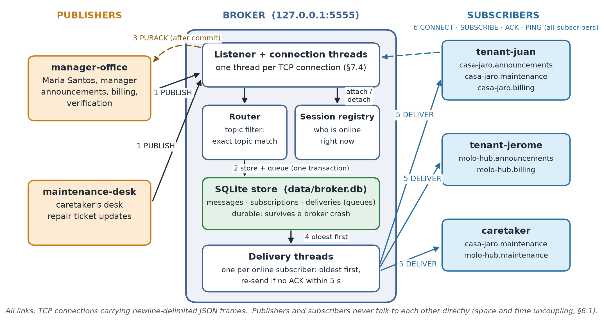

# DormCare Live Alerts: Project Compliance Audit Report

| Item | Detail |
|---|---|
| Project | DormCare Live Alerts, Option 2: Build a Publish-Subscribe Messaging System |
| Audit dates | First audit 22 November 2026. **This version: 23 November 2026, after finalization.** |
| Authoritative requirements | *Distributed Systems Course Project Assignment*, `ProjectAssignment (1).pdf` |
| Deadline used | 11:59 PM, 26 November 2026 (the document's submission section) |
| **Overall assessment** | **Implementation complete and verified. Submission not yet complete: it needs details that only the group can supply.** |

This is an internal document and is not put in the submission archive. It will become a compliance report only when
the open items in section 11 are closed. The first audit is preserved in `.backup/pre-finalization-2026-11-23.tar.gz`.

---

## Executive Summary

| Requirement group | Fully compliant | Partially compliant | Non-compliant | Unable to verify | Total |
|---|---:|---:|---:|---:|---:|
| General instructions and submission | 4 | 3 | 0 | 8 | 15 |
| Functional and technical | 15 | 0 | 0 | 0 | 15 |
| System Design Document | 7 | 0 | 1 | 0 | 8 |
| Working Prototype | 6 | 0 | 0 | 0 | 6 |
| Demonstration | 4 | 0 | 0 | 0 | 4 |
| Presentation and Q&A | 0 | 0 | 0 | 6 | 6 |
| **Total** | **36** | **3** | **1** | **14** | **54** |

All functional, prototype and demonstration-capability requirements are fully compliant. What remains:

1. **Confirm the deadline on 23 November.** The same document prints 18 November on its cover table. If that date
   applies, 23 November is the last day a late submission is accepted.
2. **Page numbers** for 12 cited sections (the one non-compliant requirement).
3. **Names, actual contributions, course, instructor, AI permission and prototype authorship.**
4. **Individual reflections**, written by each member.
5. **Rehearsal** by the people who will present.

Items 2 and 3 are entered in [team/submission_details.ini](team/submission_details.ini). Running
`scripts\make_submission.bat` then produces the final archive.

---

## Scope, Method and Limits

- **[R]** means executed and observed. **[I]** means established by inspection. **[A]** means assumed.
- Statuses are Fully compliant, Partially compliant, Non-compliant and Unable to verify.
- The final runs used a copy extracted from the submission archive.
- The textbook was not available. Top-level section numbers were checked against the authors' online contents page.
  Subsections 2.4.2, 4.2.3, 4.2.4 and 5.3.1, all page numbers and all paraphrases of the book were not checked.
- macOS, Python 3.10, separate machines and power loss were not tested.
- Claude wrote most of the project and also performed this audit. **This is not an independent review.**

---

## 1. Project Overview

A broker-based publish-subscribe middleware in Python (standard library only). It carries boarding-house notices from
two publishers to up to four scenario subscribers over seven topics, with topic filtering, durable SQLite queues and
at-least-once delivery. A dashboard and a gateway for the DormCare web prototype are optional clients.

## 2. System Architecture

| Component | File | Responsibility |
|---|---|---|
| Protocol | [protocol.py](pubsub/common/protocol.py) | Framing, message types, validation |
| Broker | [broker.py](pubsub/broker/broker.py) | Routing, delivery, ACKs, failure detection |
| Store | [store.py](pubsub/broker/store.py) | Messages, subscriptions, queues |
| Registry | [registry.py](pubsub/broker/registry.py) | Who is online |
| Publisher | [publisher.py](pubsub/publisher/publisher.py) | Publishing with retry |
| Subscriber | [subscriber.py](pubsub/subscriber/subscriber.py) | Durable session, ACK, deduplication |
| Dashboard | [dashboard/server.py](pubsub/dashboard/server.py) | Optional demonstration control room |
| Gateway | [webapp/server.py](pubsub/webapp/server.py) | Optional browser bridge |

## 3. Architecture Diagram

## 4. Requirement-by-Requirement Compliance Matrix

### 4.1 General instructions and submission

| ID | Requirement | Status | Implementation details | Files and references | Evidence | Verification |
|---|---|---|---|---|---|---|
| G-01 | Select one option | Fully compliant | Option 2 | [README](README.md#L3) | All work targets Option 2 | [I] |
| G-02 | 4 to 5 members | Unable to verify | Names not yet entered | [details file](team/submission_details.ini) | None | Group |
| G-03 | Register by end of Week 1 | Unable to verify | External | None | None | Group |
| G-04 | Option approval if shared | Unable to verify | External | None | None | Instructor |
| G-05 | No unjustified group change | Unable to verify | External | None | None | Group |
| G-06 | Members read the chapters | Unable to verify | External | None | None | Each member |
| G-07 | Cite borrowed code in README | Partially compliant | References and full AI disclosure present, two group-supplied fields empty | [README](README.md#L319) | Permission and prototype authorship are blank | [I] |
| G-08 | No plagiarism between groups | Unable to verify | External | None | None | Instructor |
| G-09 | Single .zip | Partially compliant | Builder works, output is a DRAFT until details are entered | [make_submission.py](scripts/make_submission.py) | Final build dry-run passed for 4 and 5 members | [R] |
| G-10 | Design document as .pdf or .docx | Fully compliant | Word document | [Design document](docs/System_Design_Document.docx) | Opens in Word | [R] |
| G-11 | Python codebase as folder or repository | Fully compliant | Folder | [pubsub](pubsub/) | Runs from the extracted archive | [R] |
| G-12 | Fault Test Report | Partially compliant | Content final, names and course empty | [Fault Test Report](docs/Fault_Test_Report.docx) | 45 log excerpts match the saved logs | [R] |
| G-13 | Submit by the deadline | Unable to verify | Not yet submitted | [Checklist](team/SUBMISSION_CHECKLIST.md) | None | Portal receipt |
| G-14 | Individual reflections | Unable to verify | Each member must write their own | [Outline](team/individual_reflection_outline.md) | None written | Group |
| G-15 | Python | Fully compliant | Broker and clients in Python | [pubsub](pubsub/) | Runs on 3.11 to 3.14 | [R] |

### 4.2 Functional and technical requirements

| ID | Requirement | Status | Implementation details | Files and references | Evidence | Verification |
|---|---|---|---|---|---|---|
| F-01 | Broker-based system | Fully compliant | Separate TCP broker | [broker.py](pubsub/broker/broker.py#L229) | Real processes | [R] |
| F-02 | Multiple publishers | Fully compliant | Independent clients | [publisher.py](pubsub/publisher/publisher.py#L48) | F7, I1, soak | [R] |
| F-03 | Multiple subscribers | Fully compliant | Durable client ids | [subscriber.py](pubsub/subscriber/subscriber.py#L80) | F4, I1, soak | [R] |
| F-04 | Route by subscription | Fully compliant | Lookup inside the publish transaction | [broker.py](pubsub/broker/broker.py#L366) | I1 | [R] |
| F-05 | Register interest | Fully compliant | SUBSCRIBE and SUBACK | [broker.py](pubsub/broker/broker.py#L350) | X1, X3 | [R] |
| F-06 | Only matching messages | Fully compliant | Filter at broker | [store.py](pubsub/broker/store.py#L143) | F3, soak: 0 misrouted | [R] |
| F-07 | Demonstrate with reference to §6.3 | Fully compliant | Explained and cited (page: D1-08) | Design document §5 | Runbook steps 2 to 4 | [R] |
| F-08 | At-least-once delivery | Fully compliant | Deliverability check, commit, PUBACK, ACK, retry | [check](pubsub/broker/broker.py#L67), [delivery](pubsub/broker/broker.py#L414) | R1, X2, X4, soak: 0 lost | [R] |
| F-09 | No loss during disconnection | Fully compliant | Queue, replay, safe message identity | [subscriber.py](pubsub/subscriber/subscriber.py#L40) | X1, R2, soak | [R] |
| F-10 | Persistent queues | Fully compliant | SQLite rows per subscriber | [store.py](pubsub/broker/store.py#L52) | X3, X10, F8 | [R] |
| F-11 | Compare filtering models | Fully compliant | Eight criteria | Design document §8.2 | Present | [I] |
| F-12 | Justify the decision | Fully compliant | Reasons and cost | Design document §8.3 | Present | [I] |
| F-13 | Real-world scenario | Fully compliant | Boarding-house alerts | [scenario](pubsub/scenario/dormcare_scenario.json) | I1 | [R] |
| F-14 | At least 2 publishers | Fully compliant | 2 | [scenario](pubsub/scenario/dormcare_scenario.json#L13) | I1 | [R] |
| F-15 | At least 3 subscribers, different topics | Fully compliant | 4 subscribers, 7 topics | [scenario](pubsub/scenario/dormcare_scenario.json#L17) | I1 | [R] |

### 4.3 System Design Document

| ID | Requirement | Status | Implementation details | Files and references | Evidence | Verification |
|---|---|---|---|---|---|---|
| D1-01 | At least 6 pages | Fully compliant | 22 pages | [Design document](docs/System_Design_Document.docx) | Word page count | [R] |
| D1-02 | Architecture and diagram | Fully compliant | Figure 1 | §3 | Matches code | [I] |
| D1-03 | Protocol and routing | Fully compliant | Messages, errors, limits | §4, §5.2 | Matches tested behavior | [R] |
| D1-04 | Filtering and registration | Fully compliant | Mechanism explained | §5 | Matches code | [I] |
| D1-05 | Queues and reconnection | Fully compliant | Schema, guarantees, assumptions | §6 | Matches tested behavior | [R] |
| D1-06 | Comparison with §6.3 | Fully compliant | Table and justification | §8 | Present | [I] |
| D1-07 | Scenario | Fully compliant | Actors, topics, storyline | §2 | Matches scenario file | [I] |
| D1-08 | 8 or more citations with section and page | Non-compliant | 12 entries have sections, none has a page | §12 | 12 values to enter, filling 28 fields | [R] |

### 4.4 Working Prototype

| ID | Requirement | Status | Implementation details | Files and references | Evidence | Verification |
|---|---|---|---|---|---|---|
| D2-01 | Separated components | Fully compliant | Three packages | [pubsub](pubsub/) | Separate processes | [R] |
| D2-02 | README with setup and run steps | Fully compliant | Quick start and manual start | [README](README.md#L74) | Launcher tested from the archive | [R] |
| D2-03 | requirements.txt | Fully compliant | No third-party packages | [requirements.txt](requirements.txt) | Clean runs | [R] |
| D2-04 | Topic routing | Fully compliant | Demonstrated | [tests](tests/test_integration.py) | I1 | [R] |
| D2-05 | At-least-once | Fully compliant | Fault injection | [tests](tests/test_faults.py) | X2, X4 | [R] |
| D2-06 | Reconnect with catch-up | Fully compliant | Ordered replay | [tests](tests/test_faults.py) | X1, X1b | [R] |

### 4.5 Demonstration (prepared capability)

| ID | Requirement | Status | Implementation details | Files and references | Evidence | Verification |
|---|---|---|---|---|---|---|
| D3-01 | Prepared full demonstration | Fully compliant | Launcher, runbook, dashboard | [Runbook](docs/Demo_Runbook.md#L54) | [Saved result](docs/evidence/runbook_results.txt) | [R] |
| D3-02 | Subscriber disconnects | Fully compliant | Crash script | [crash.ps1](scripts/crash.ps1) | Step 5 | [R] |
| D3-03 | Queued messages on return | Fully compliant | Catch-up | [subscriber.py](pubsub/subscriber/subscriber.py#L218) | Step 9 | [R] |
| D3-04 | Filtering in action | Fully compliant | Two properties | [Runbook](docs/Demo_Runbook.md#L78) | Steps 2 to 4 | [R] |

### 4.6 Final Presentation and Q&A

All six depend on a future live event.

| ID | Requirement | Status | Implementation details | Files and references | Evidence | Verification |
|---|---|---|---|---|---|---|
| D4-01 | 15 minutes plus Q&A | Unable to verify | 10 slides with notes, timed plan | [Slides](docs/Presentation.pptx) | Material only | Rehearsal |
| D4-02 | All members speak | Unable to verify | Parts planned, no names | [Guide](docs/Presentation_and_QA_Guide.md#L9) | None | Group |
| D4-03 | Live scenario demo | Unable to verify | Six minutes planned, procedure tested | [Runbook](docs/Demo_Runbook.md#L78) | Automated run only | Rehearsal |
| D4-04 | Architecture walkthrough | Unable to verify | Slides 4 to 8 | [Slides](docs/Presentation.pptx) | Material only | Rehearsal |
| D4-05 | Relationship to Chapter 6 | Unable to verify | Slides 2, 6, 7 and 9 | [Slides](docs/Presentation.pptx) | Material only | Rehearsal |
| D4-06 | Individual understanding | Unable to verify | Q&A bank | [Guide](docs/Presentation_and_QA_Guide.md#L36) | Cannot be shown by files | Mock Q&A |

### 4.7 Rubric readiness (not a predicted mark)

| Criterion | Points | Readiness |
|---|---:|---|
| Architecture and design document | 20 | Ready once pages and names are entered |
| Working code | 30 | Ready |
| Demonstration | 30 | Ready to rehearse on the presentation laptop |
| Presentation and Q&A | 20 | Material ready. Depends on each member's own understanding. |

## 5. Technical Implementation Details

| Mechanism | Implementation |
|---|---|
| Storage | `messages`, `subscriptions` and `deliveries` tables in SQLite WAL mode |
| Publish | Validate, check deliverability, commit, PUBACK, wake delivery threads |
| Deliver | Oldest first, window of 50, resend after 5 s, delete on ACK |
| Message identity | `(publisher, msg_id)` at the broker, `(seq, published_at)` at subscribers |
| Limits | 64 KiB frame, 64 payload levels, 5 publisher retries |
| Concurrency | Reader thread per connection, delivery thread per subscriber, explicit locks |

## 6. Distributed Systems Concepts Applied

| Concept | Section | Application |
|---|---|---|
| Failure model | 2.4.2 | Crash and omission faults, timeouts |
| Stream communication | 4.2.4 | Framing over TCP |
| External data representation | 4.3 | UTF-8 JSON |
| Request-reply | 5.2 | PUBLISH and PUBACK with id and history |
| Invocation semantics | 5.3.1 | Retransmission and duplicate filtering |
| Space and time uncoupling | 6.1 | Topics and durable queues |
| Ordering | 6.2 | One broker sequence |
| Publish-subscribe | 6.3 | Topic filtering through a broker |
| Message queues | 6.4 | One persistent queue per subscriber |
| Threads | 7.4 | Thread per connection |

## 7. Communication and Data Flow

1. The subscriber sends CONNECT and SUBSCRIBE. The broker saves the subscription.
2. The publisher sends PUBLISH. The broker checks it, commits it with one queue row per match, then sends PUBACK.
3. The delivery thread sends DELIVER, oldest first.
4. The subscriber processes the message, records its identity and sends ACK. The broker deletes the queue row.
5. An offline subscriber's rows wait until it reconnects with the same id.

Browsers use HTTP and server-sent events to the gateway, which speaks the same TCP protocol to the broker.

## 8. Fault Tolerance and Reliability Mechanisms

| Failure | Handling | Test |
|---|---|---|
| Subscriber crash | Queue and catch-up | X1, X1b |
| Crash before ACK | Redeliver and deduplicate | X2 |
| Silent client | Heartbeat timeout | X6 |
| Broker crash | Reload from SQLite, clients reconnect | X3, X3b |
| Lost PUBACK | Retry and deduplicate | X4 |
| Undeliverable message | Refuse before PUBACK | R1 |
| Database reset | Identity includes publish time | R2, E13 |
| Duplicate client id | Older client stops | X7, R6 |
| Malformed input | ERROR, connection kept | X5, R8, R9 |

## 9. Testing and Verification Results

| Check | Result | Evidence |
|---|---|---|
| Windows, Python 3.11, 3.13, 3.14 | 95 of 95 passed | [Matrix](docs/evidence/test_matrix.txt) |
| Linux (WSL 2), Python 3.12, five runs | 86 passed and 9 Windows-only skipped, each run | [Matrix](docs/evidence/test_matrix.txt) |
| Crash soak, three seeds | 6,000 messages, 15 broker kills, 0 lost, misrouted or reordered | [Soak](docs/evidence/soak_results.txt) |
| Browser checks | 19 of 19 passed | [Browser](docs/evidence/browser_results.txt) |
| Runbook through the real scripts | All steps and both extras passed | [Runbook](docs/evidence/runbook_results.txt) |
| Injected bugs | 10 of 10 caught | Development check, no saved log |

During verification one Linux run failed test I1. The cause was a timeout in the test. It was reproduced, fixed and
recorded in Section 7 of the Fault Test Report. One later Linux run was interrupted from outside and is not counted.

## 10. Demonstration Guide

- **Terminals:** `scripts\reset_data.bat`, then `scripts\start_demo.bat`, then [runbook section 3](docs/Demo_Runbook.md#L78).
- **Browser:** `scripts\start_dashboard.bat`, then [runbook section 0](docs/Demo_Runbook.md#L11).
- Rehearse on the presentation laptop and keep a recording as backup.

## 11. Issues Resolved and Remaining

### 11.1 Resolved

| ID | Defect | Regression check |
|---|---|---|
| D-01 | Launcher started no subscribers | S1 |
| D-02 | Accepted message could block a queue forever | R1 |
| D-03 | Database reset caused silent discards | R2, E13 |
| D-04 | `status` could end the publisher | R4 |
| D-05 | Subscriber script failed from PowerShell | S3 |
| D-06 | Duplicate-id eviction loop | R6 |
| D-07 | Second window erased alerts | E15, E16 |
| D-08 | Oversized CONNACK and STATUS | R7 |
| D-09 | Newline accepted in names | R8 |
| D-10 | Malformed input dropped connections | R9 |
| D-11 | `send 0` sent the last event | R5 |
| D-12 | Launcher broke with Git's `find` | S2 |
| D-13 | Non-portable archive paths | P2 |
| D-14 | Broker payload could inject HTML into the website (found during finalization) | E18 |
| D-15 | 32-bit message ids could collide (found during finalization) | R3 |
| D-16 | `--status` crashed on a broken listener (found during finalization) | R4c |

The inaccurate documentation statements listed in the first audit were corrected.

### 11.2 Open, for the group

| Priority | Item |
|---|---|
| P0 | Confirm 26 November with the instructor |
| P0 | Obtain written permission for AI-generated code. An earlier copy of the brief prohibited it. The authoritative copy does not contain that rule. |
| P1 | Complete [submission_details.ini](team/submission_details.ini) and check the four unverified subsection numbers |
| P1 | Write individual reflections |
| P1 | Build, inspect and upload the final archive |
| P2 | Assign speakers, rehearse, hold a mock Q&A |

### 11.3 Known limitations left in the design

- One broker, so no service while it is down.
- No authentication, encryption or topic access control. Per-tenant topics are not private against a deliberate client.
- The local web servers accept requests from any origin.
- Exact-match topics only.
- No publisher outbox.
- The message log is never trimmed.
- The website never unsubscribes a tenant who moves.
- Power-loss durability is not guaranteed.

These are disclosed in the README and design document. None is an assignment requirement.

## 12. Conclusion

The implementation meets the Option 2 functional, prototype and demonstration requirements, as verified by execution
on the submitted files. The project as a submission is **not yet fully compliant**: page citations, group details,
individual reflections and the live presentation can only be completed by the group.
